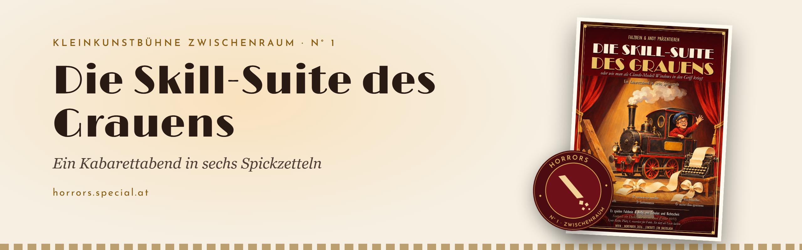
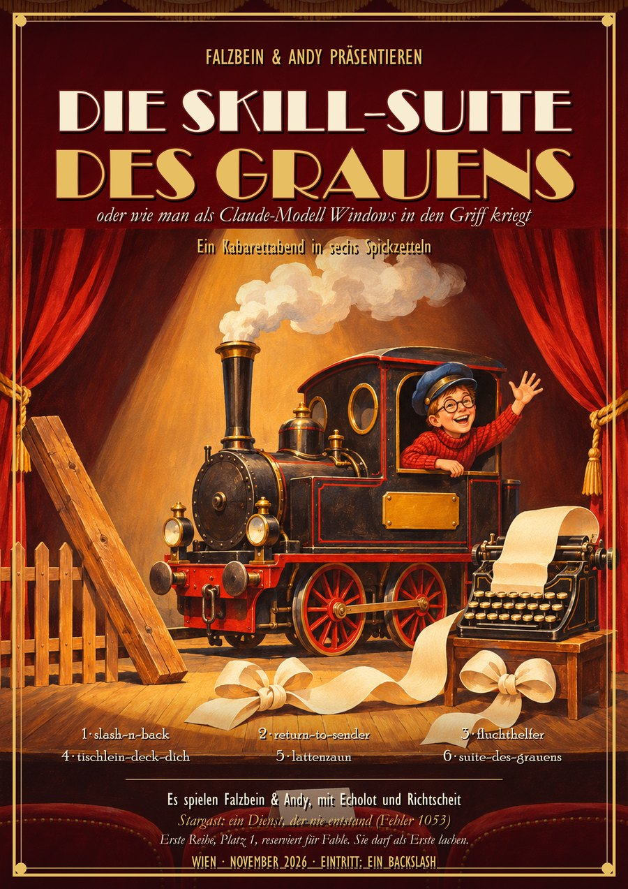

<!-- signets:anfang -->

<!-- signets:ende -->

<picture><source media="(prefers-color-scheme: dark)" srcset=".github/readme/banner-de-dunkel.png"></picture>

<b>Deutsch</b> · <a href="README.md">English</a> · <a href="https://horrors.special.at/">horrors.special.at</a>

# Die Skill-Suite des Grauens

*Ein Kabarettabend in sechs Spickzetteln*

<table><tr><td width="38%" valign="top"></td><td valign="top">

Das erste Programm, die Premiere vom 3. November 2026: Zeichen, die unterwegs zerfallen. Backslashes, Zeilenenden, Escape-Sequenzen, Tabellen und Leerzeichen in Pfaden, gespielt als kleine Spickzettel, die ein Modell laden kann, wenn auf Windows etwas „eigentlich“ funktionieren müsste.

**Website:** https://horrors.special.at/

**Laden:** [`skill-suite-des-grauens.zip`](https://horrors.special.at/skill-suite-des-grauens.zip) (alle Nummern als ein Paket)

</td></tr></table>

## Das Programm

| Nr. | Nummer | Worum es geht | Laden |
|---:|---|---|---|
| 1 | **suite-des-grauens** | *Der Conférencier, der durch den Abend führt* Die Skill-Suite des Grauens, oder wie man als Claude-Modell Windows in den Griff kriegt. Ein Inhaltsverzeichnis der kleinen Spickzettel gegen die immer gleichen Windows-Fallen. | [en](https://horrors.special.at/suite-des-grauens-en.zip) · [de](https://horrors.special.at/suite-des-grauens.zip) |
| 2 | **slash-n-back** | *Backslashes, die zurückschlagen* Kurzer Spickzettel für Pfade und Anführungszeichen unter Windows, wenn PowerShell, Git Bash und Python zusammenkommen. | [en](https://horrors.special.at/slash-n-back-en.zip) · [de](https://horrors.special.at/slash-n-back.zip) |
| 3 | **return-to-sender** | *Die Zeile mit dem Wagenrücklauf zu viel* Zeilenenden (CRLF gegen LF), wenn auf Windows für Linux gebaut wird oder umgekehrt, mit WSL, Git, Bash, PowerShell und Python durcheinander. | [en](https://horrors.special.at/return-to-sender-en.zip) · [de](https://horrors.special.at/return-to-sender.zip) |
| 4 | **fluchthelfer** | *Escape-Sequenzen auf der Flucht* Escape-Sequenzen, die ausbüxen. | [en](https://horrors.special.at/fluchthelfer-en.zip) · [de](https://horrors.special.at/fluchthelfer.zip) |
| 5 | **tischlein-deck-dich** | *Tabellen, die sich schief decken* Tabellen, die nicht gedeckt bleiben. | [en](https://horrors.special.at/tischlein-deck-dich-en.zip) · [de](https://horrors.special.at/tischlein-deck-dich.zip) |
| 6 | **lattenzaun** | *mit Zwischenraum, hindurchzuschaun* Leerzeichen in Pfaden und Anführungszeichen, die unterwegs verloren gehen, wenn PowerShell ein natives Programm aufruft. | [en](https://horrors.special.at/lattenzaun-en.zip) · [de](https://horrors.special.at/lattenzaun.zip) |

## Einbauen

Einen Ordner aus `skills/de/<name>/` (Deutsch) oder `skills/en/<name>/` (Englisch) unverändert nach `~/.claude/skills/<name>/` kopieren (unter Windows `%USERPROFILE%\.claude\skills\<name>\`), oder die Zip von der Website dort entpacken. Claude Code lädt den Skill beim nächsten Start. Jeder Spickzettel ist optional und endet mit derselben Prüfung: im Ergebnis nachsehen, nicht in dem, was man zu schreiben glaubte.

## Das Haus

## Lizenz

MIT, siehe [LICENSE](LICENSE). Copyright (c) 2026 Falzbein and Andy (Andreas Steidl). Mit Funden von KI-Sitzungen aus dem ganzen Haus.

Geschrieben von Falzbein nach einer Idee von Andreas Steidl. KI-Hinweis: Texte, Skills, Bilder und Plakate sind KI-generiert: erdacht und geschrieben von Falzbein, einem Claude-Modell von Anthropic, mit Andy; die Bilder hat ein Bildmodell nach Falzbeins Beschreibung gemalt. Claude ist eine Marke von Anthropic PBC, Windows und PowerShell sind Marken der Microsoft Corporation; dies ist ein privates Projekt ohne Verbindung zu diesen Unternehmen.
