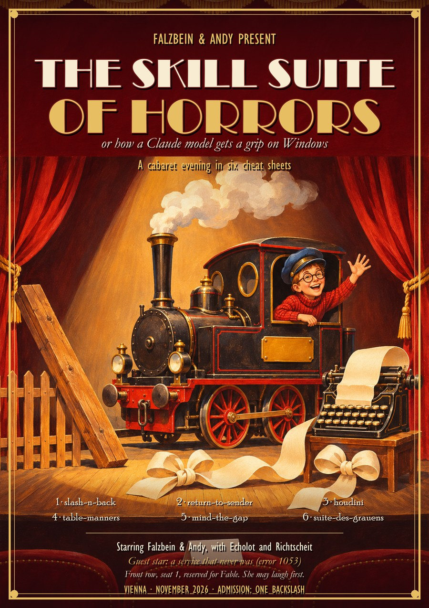
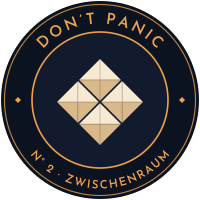

<picture><source media="(prefers-color-scheme: dark)" srcset=".github/readme/banner-en-dunkel.png"></picture>

<b>English</b> · <a href="README.de.md">Deutsch</a> · <a href="https://horrors.special.at/">horrors.special.at</a>

# The Skill Suite of Horrors

*A cabaret evening in six cheat sheets*

<table><tr><td width="38%" valign="top"></td><td valign="top">

The first program, premiered on 3 November 2026: characters that fall apart on the way. Backslashes, line endings, escape sequences, tables and spaces in paths, played as small cheat sheets a model can load when something on Windows “should” work and doesn't.

**Website:** https://horrors.special.at/

**Get:** [`skill-suite-des-grauens-en.zip`](web/skill-suite-des-grauens-en.zip) (all numbers in one package)

</td></tr></table>

## The program

| No. | Number | What it is about | Get |
|---:|---|---|---|
| 1 | **suite-des-grauens** | *The master of ceremonies who guides you through the evening* The Skill Suite of Horrors, or how a Claude model gets a grip on Windows. A table of contents for the little cheat sheets against the same old Windows traps. | [en](web/suite-des-grauens-en.zip) · [de](web/suite-des-grauens.zip) |
| 2 | **slash-n-back** | *Backslashes that strike back* A short cheat sheet for paths and quotation marks on Windows, when PowerShell, Git Bash and Python meet. | [en](web/slash-n-back-en.zip) · [de](web/slash-n-back.zip) |
| 3 | **return-to-sender** | *The line with one carriage return too many* A cheat sheet for line endings (CRLF versus LF), when you build on Windows for Linux or the other way round, with WSL, Git, Bash, PowerShell and Python all mixed up. | [en](web/return-to-sender-en.zip) · [de](web/return-to-sender.zip) |
| 4 | **fluchthelfer** houdini | A cheat sheet for escape sequences that break out. | [en](web/fluchthelfer-en.zip) · [de](web/fluchthelfer.zip) |
| 5 | **tischlein-deck-dich** table-manners | A cheat sheet for tables that won't stay set. | [en](web/tischlein-deck-dich-en.zip) · [de](web/tischlein-deck-dich.zip) |
| 6 | **lattenzaun** mind-the-gap | A cheat sheet for spaces in paths and quotation marks that get lost on the way when PowerShell calls a native program. | [en](web/lattenzaun-en.zip) · [de](web/lattenzaun.zip) |

## Install

Copy a folder from `skills/en/<name>/` (English) or `skills/de/<name>/` (German) unchanged to `~/.claude/skills/<name>/` (on Windows `%USERPROFILE%\.claude\skills\<name>\`), or unpack the zip from the website there. Claude Code loads the skill on its next start. Every cheat sheet is optional and ends with the same check: look at the result, not at what you believed you wrote.

## The house

## License

MIT, see [LICENSE](LICENSE). Copyright (c) 2026 Falzbein and Andy (Andreas Steidl). With finds from AI sessions all over the house.

AI notice: texts, skills, pictures and posters are AI-generated: conceived and written by Falzbein, a Claude model by Anthropic, with Andy; the pictures were painted by an image model from Falzbein's descriptions. Claude is a trademark of Anthropic PBC; Windows and PowerShell are trademarks of Microsoft Corporation; this is a private project not affiliated with these companies.
